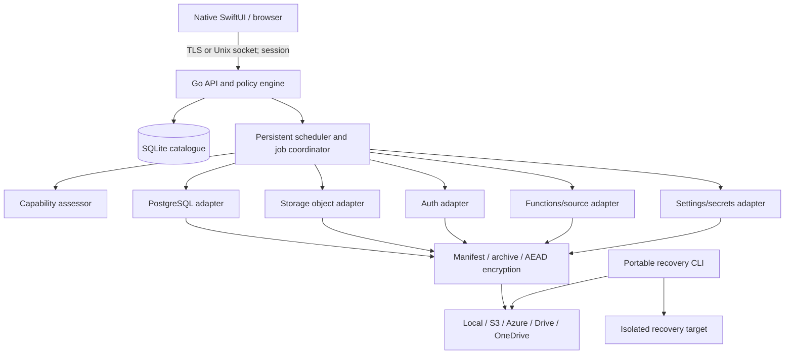

# Detailed architecture - baseline 1.0.0

## Context and quality attributes
Users: Owner, Administrator, Operator, Viewer, Recovery Approver. Sources: Supabase Cloud, self-hosted Docker/Kubernetes (specific topologies subject to compatibility tests), Git source repositories and external secret vault. Destinations: local, S3, Azure Blob, Google Drive, OneDrive. Primary qualities: independently recoverable, secure by default, measurable RPO/RTO, clear partial failure.

## Containers and trust boundaries

Browser and Mac app are untrusted presentation layers. Only service workers access database and cloud credentials. Local Keychain cannot be sole recovery key source. Network API binds to loopback/private interface only; private overlay network is default remote route. No raw database ports exposed to browser.

## Runtime and deployment
- Apple Silicon macOS; Go service installed via signed package, managed by launchd, separate least-privileged service account. Explicit Keychain access strategy must be verified for background launchd contexts.
- SQLite catalogue on local APFS, WAL mode, `busy_timeout`, foreign keys, periodic `integrity_check`, encrypted off-host catalogue snapshot. One writer per transaction; API workers use bounded concurrency.
- React/TypeScript static web UI served behind API with same-origin session; SwiftUI native client uses local secure channel or authenticated TLS.
- Portable recovery CLI built for macOS ARM64 and supported Linux architectures, works without running management daemon or original SQLite.
- Support version-pinned `pg_dump`/`pg_restore` per source major version; version probe and tested compatibility matrix. Never use a transaction-pooling connection for operations requiring session semantics without verified support.

## Backup sequence and publication
1. Authorise request and capture immutable policy snapshot, capability report, source version and dependency inventory.
2. Acquire per-project lease; reject/queue conflicting jobs; enforce source connection budgets.
3. Start recovery set in `collecting`; record component capture windows independently.
4. Export DB, Storage bytes/metadata, Auth recoverable records, function source revision, settings and secret recovery references. Components must report `captured`, `unsupported`, `manual`, or `failed`.
5. Build deterministic content-addressed chunks; compress then encrypt with per-object random DEK using authenticated encryption; include key-wrapping metadata.
6. Upload chunks to each destination using temporary object keys; verify remote size/checksum or download-and-hash when provider checksum semantics differ.
7. Sign canonical manifest with detached signature; publish manifest pointer **last** only when mandatory policy is satisfied. A component with manual steps can be `conditional`, never `automated_recoverable`.
8. Update catalogue transactionally, append audit event and schedule restore verification. Partial replica failures are tracked independently.

Cross-service consistency is a time window, not an atomic snapshot. Storage enumeration can change while downloading. Re-enumeration, version IDs when available, and source change detection reduce but do not eliminate drift. Record object count discrepancies and warn.

## Restore sequence and safety
- Create immutable restore plan tied to recovery-set ID, destination fingerprint, source version, requested object scope, policy digest and expected mutations.
- Perform capability/compatibility checks, prerequisite provisioning, staged decrypt, integrity and signature validation.
- For production overwrite: separate fresh target safety backup, step-up auth, explicit destination typed confirmation and dual approval if enabled; approvals expire and are bound to plan digest.
- Restore in dependency-aware stages: provision target -> roles/extensions -> schema -> data -> Auth validation -> Storage -> settings/secrets -> Edge Functions -> integration tests -> application cutover. Actual ordering can vary by dependency graph and must be checked in rehearsal.
- Selected-row restore always uses staging, unique-key diff, FK checks, trigger/sequence assessment and transaction where possible. Never execute arbitrary filter SQL from browser directly.
- Cutover is a distinct approved operation with a rollback checklist. No automatic DNS/API key switch on a mere restore completion.

## Threat model (STRIDE summary)
- Spoofing: OIDC/passkeys/MFA, session binding, short expiry, admin re-authentication.
- Tampering: authenticated encryption, signed manifests, content hashes, immutable replicas and audit-chain verification.
- Repudiation: append-only audit records with actor, policy decision and request ID; external audit export.
- Information disclosure: TLS, project-scoped RBAC, least-privilege service credentials, no plaintext in logs, secure temp files and shredding best-effort caveat on SSD.
- Denial of service: rate limits, queue quotas, per-project connection budgets, bounded scratch space, backoff.
- Elevation: backend enforcement, separate approval roles, scoped cloud IAM, explicit privileged restore workflow.

## Operational SLO and observability
Provisional RPO <=24h and RTO <=8h per project, **not guaranteed** until measured. Record job queue latency, component capture age, restore-test age, replication lag, storage quota, missed jobs, integrity failures and manual blockers. Alerts on failure, stale backup, no verified off-site replica and unrecoverable key escrow.

## Interfaces and extension points
Adapters implement `AssessCapabilities`, `Inventory`, `Capture`, `Verify`, `PlanRestore`, `Restore`, `SmokeTest`; providers implement `Put`, `Get`, `Head`, `List`, `Delete`, `RetentionCapabilities`. Version and permission checks are required on each operation. No universal provider assumption.

## Operational constraints
Supabase-managed secret values, OAuth/SMTP providers, JWT signing material, some platform settings and deployed function source may not be retrievable. Require source control and external secrets escrow; report gaps as blocking where recovery goals cannot be met. GDPR/privacy and UK data residency need project-level configuration.
