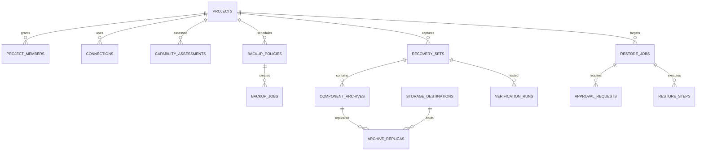

# Catalogue data model

## Entity relationships

## Invariants
1. No archive object can be marked verified without verified ciphertext digest and manifest linkage. Restore-tested is a distinct property.
2. A recovery set is published only after policy-mandatory components have a terminal capture status and publication checks pass. `conditional` means manual recovery obligations remain.
3. Archive replicas have independent upload/verification/deletion status. Retention never deletes the final verified recoverable replica.
4. Credential values never enter SQLite; `secret_ref` is an opaque lookup identifier.
5. All project-scoped records have project ownership either directly or via immutable parent; enforce in API as well as SQL.
6. Approval references a plan digest, requester, approver, expiry and target fingerprint; no self-approval when dual control enabled.
7. Every state transition and destructive operation emits an audit event with a stable request ID.
8. IDs use UUID strings; times use UTC RFC3339; size is integer bytes; durations are milliseconds; SQLite foreign keys ON.

## Lifecycle states
- Job: queued -> running -> uploading -> verifying -> completed | partial_failure | failed | cancelled. Recovery after crash reconciles non-terminal states.
- Recovery set: collecting -> staged -> published | conditional | failed. A `published` set is not necessarily restore-tested.
- Restore: drafted -> assessed -> awaiting_approval -> approved -> running -> validating -> succeeded | failed | rolled_back.

## Migrations
`data/schema.sql` is the initial migration baseline, not a final optimised physical design. Apply in a transaction, use a schema_migrations table and test migration on a copy before production. Index project/time/state lookups. Secrets and archive bytes live outside this catalogue.
